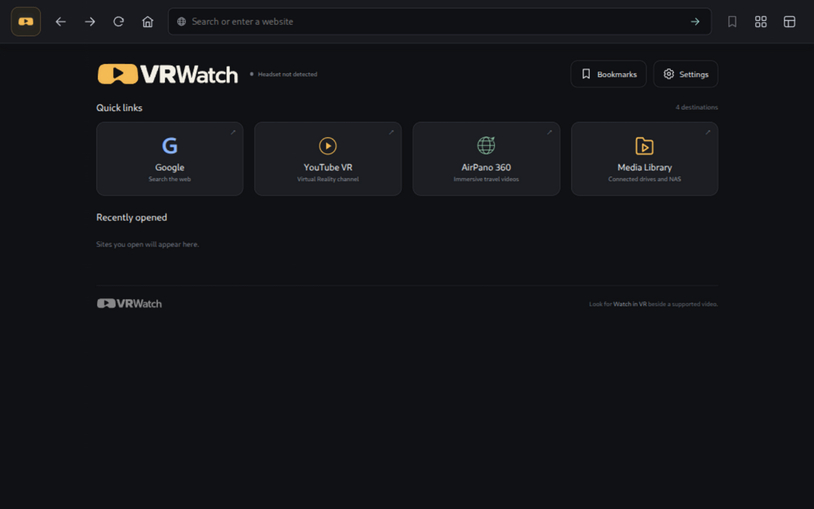

  <picture>
    <source media="(prefers-color-scheme: dark)" srcset="branding/vrwatch-wordmark-color-light.svg">
    
  </picture>

<strong>A clean, fast browser for Steam Frame.</strong>

Surf the web without clutter. Find a video and watch it on a huge virtual screen,
or step inside 180° and 360° footage—all from your headset.

VRWatch uses hardware acceleration for smoother supported video playback with
less work for the CPU. It is designed to improve performance and help your battery
last longer. Battery-life gains haven't been measured yet.

## Make yourself at home

- **Simple browsing.** Search or enter an address, switch tabs, and get back Home
  with controls that stay within reach.
- **Your favorite places.** Save bookmarks, organize them into folders, and choose
  up to five Quick Links for Home.
- **A bigger screen.** Watch everyday videos on a virtual cinema screen, or choose
  180°, 360° and 3D formats for footage made for them.
- **Easy video controls.** Point and press the trigger to seek or change volume.
  Press B on the right controller or squeeze a grip to open the playback panel.
- **Your own videos.** Browse connected media folders and mounted network drives
  through Media Library.
- **Make it comfortable.** Choose bigger text and controls, your search engine,
  and whether VRWatch remembers recently opened sites or restores your tabs.

## Get VRWatch on Steam Frame

1. Open [Releases](https://github.com/akalajzi/VRWatch/releases) and download the
   **Steam Frame** package from the newest release. You don't need the source files.
2. Follow the [installation guide](INSTALL.md) to extract it on Frame and run
   **Install VRWatch.sh**.
3. Launch **VRWatch** from your Steam library.

The package includes the browser and VRWatch app. You don't need to compile
anything or set up a browser extension.

**Early preview:** some websites and videos may not work yet. Hardware video
decoding supports compatible H.264 videos; other formats may use software decoding
or be unsupported. Streaming-service DRM can prevent VR playback.

## Start watching

Open a site and start its video. Look for **Watch in VR** or **Watch on VR screen**
beside the player. If the picture looks wrong, open **⋯** and choose its format.
Exit VR to return to the page where you left off.

VRWatch keeps its bookmarks, history and saved previews on your device. Settings
lets you clear history and previews without deleting your bookmarks. Its optional
YouTube focus view hides page clutter; it isn't an ad blocker.

---

[Install and troubleshoot](INSTALL.md) · [Development](DEVELOPING.md) ·
[Contributing](CONTRIBUTING.md) · [License](LICENSE) · [Credits](NOTICE.md)

VRWatch is an independent project, not affiliated with Valve or Google.
